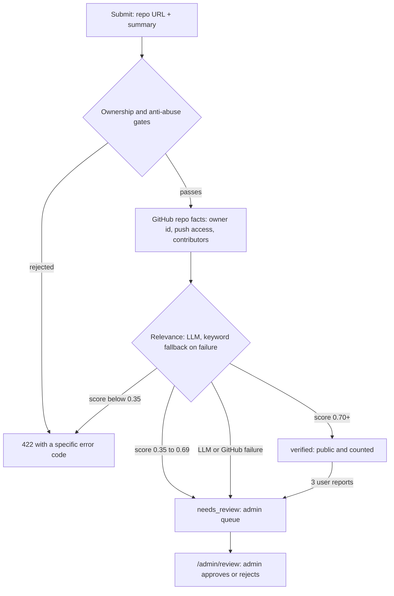

# MANABI

MANABI is a catalog of real problems worth building. Students pick a brief,
link their GitHub repo, and the site tracks their progress from public repo
activity. A chat assistant helps you choose, and everything runs on a single
FastAPI service that also serves the built frontend.

Problem briefs are curated manually, via seed scripts and the app itself; the
app needs no network sources. Automated crawling was evaluated early on and
intentionally removed: several public sources prohibit scraping. The seed files
fill in web, mobile, ML, data science, cloud, cybersecurity, systems, and web3
briefs.

## What the app does

- Problem board with search plus field, difficulty, and domain filters
- Problem detail pages with tech stack, build guide, and future ideas
- Submit a project by repo URL (owner/push-access/contributor gates plus an
  LLM relevance check)
- Progress tracking from the GitHub API: commits, README state, open issues,
  cached for 10 minutes with a manual refresh
- Verified projects can earn the "Completed" tick (README plus 5 commits,
  re-checked against GitHub at mark-complete time)
- Dashboard that lists your projects with edit/complete/remove/reopen actions;
  unverified work stays in the needs-review state and is hidden from the
  curated counts until an admin or the verification system clears it
- Viewer reports on published projects; 3 reports flip a project back to
  human review
- Catalog chat (login-only, 20 messages per account per rolling 24 h) with an
  honest mock provider so the app runs fully offline
- `GET /api/recommendations` scores briefs against your GitHub profile signals
  (topics and languages)
- Admin submissions queue at `/admin/review` (approve/reject), gated by
  `ADMIN_GITHUB_USERNAMES`
- Night mode with a persisted toggle (falls back to the OS preference)

## How it fits together

**One service:** FastAPI serves the built React app from `frontend/dist` at
`/` (with SPA fallback) and keeps every API route under `/api`. No nginx is
needed; put your platform's TLS or load balancer in front of uvicorn. SQLite
is the local default, managed Postgres (Neon/Supabase) is the production path,
and the `postgres://` scheme is rewritten with `pool_pre_ping` enabled
automatically. Health check: `GET /api/health` returns `{"status":"ok"}` after
touching the database.

The OpenAPI contract lives at `docs/openapi.json` (regenerate frontend types
with `npm run gen:api` in `frontend/`).

## Project submission and verification

Submitting a repo is gated hard. Anti-abuse limits (5 submissions per rolling
24 h, 10 active projects, 10 submit-button attempts per hour, one repo per
problem, forks and archived repos off) apply before GitHub is even contacted. Then the ownership gate accepts exactly
one verifiable basis: the repo owner by GitHub numeric id, push or admin
access for org repos, or 3 or more commits under your own account. An LLM then
judges your README plus summary against the problem brief.



The design rule is failure safety: any LLM or GitHub outage degrades to human
review, never to an unearned verified badge. Pre-existing repos (older than
180 days) need a higher score to auto-verify, a project in needs-review
re-checks itself at most once per day on progress refresh, and editing the
summary re-runs the check right away. All knobs are
documented in `backend/.env.example` with their defaults, and the rules live
in `backend/app/services/verification.py`.

## Tech stack

| Layer | Choice | Notes |
|---|---|---|
| Backend | FastAPI, SQLAlchemy 2, Alembic | Python 3.11+ (Render image pins 3.12) |
| Database | SQLite locally, Postgres in prod | migrations are the source of truth in prod |
| Auth | GitHub OAuth via Authlib + itsdangerous sessions | tokens stored server-side |
| AI | Gemini or Anthropic, `mock` provider by default | keys optional; chat degrades to 503 without them |
| Frontend | Vite, React 18, TypeScript, Tailwind CSS 4 | React Query for data, motion & Radix for UI |
| Tests | pytest + respx, Vitest + Testing Library + MSW, Playwright | LLM forced to mock in backend tests |
| Deploy | Render blueprint (`render.yaml`), plain uvicorn | single service, no separate web tier |

## Repo layout

```
MANABI/
├── backend/
│   ├── app/
│   │   ├── routers/       # problems, projects, auth, chat, admin, stats, ...
│   │   ├── services/      # github, verification, llm, ratelimit, catalog_search, ...
│   │   ├── seed/          # project-importer + seed runners
│   │   ├── models.py      # SQLAlchemy models
│   │   ├── schemas.py     # Pydantic request/response models
│   │   ├── config.py      # all env vars and their defaults
│   │   └── main.py        # app assembly, SPA serving, health
│   ├── alembic/           # migrations (source of truth for Postgres)
│   ├── scripts/           # seed_*_web_projects.py, reverify_projects.py, export_openapi.py
│   ├── .env.example       # every setting with comments and defaults
│   ├── requirements.txt   # runtime deps (pinned)
│   ├── requirements-dev.txt
│   └── start.sh           # prod entrypoint: pip install + uvicorn
├── frontend/
│   ├── src/
│   │   ├── api/           # typed client + MSW mock handlers
│   │   ├── components/    # chat, problems, home, layout, markdown, auth
│   │   ├── pages/         # board, detail pages, dashboard, admin, static pages
│   │   ├── hooks/         # query hooks and mutations
│   │   ├── lib/           # small reusable logic (theme, repo URL rules, ...)
│   │   ├── design/        # primitive components (Input, Dialog, Toast, ...)
│   │   └── test/          # render helpers and setup
│   ├── e2e/               # Playwright smoke test
│   └── dist/              # build output, never committed, built on deploy
├── docs/
│   ├── openapi.json       # machine-readable API contract
│   ├── TESTING_2026-11-09.md
│   └── PERF_2026-11-09.md
└── DEPLOY.md              # full production runbook (read this to deploy)
```

## Quick start (local dev)

```sh
# Terminal 1, backend
cd backend
python -m venv .venv
.venv/Scripts/pip install -r requirements.txt     # macOS/Linux: .venv/bin/pip
copy .env.example .env                            # then edit secrets (never commit .env)
.venv/Scripts/python -m alembic upgrade head
.venv/Scripts/python scripts/seed_beginner_web_projects.py
.venv/Scripts/python -m uvicorn app.main:app --port 8000

# Terminal 2, frontend
cd frontend
npm ci
npm run dev                                       # http://localhost:5173 (proxies /api -> :8000)
```

Python 3.11+ and Node 20 (see `.node-version`: 20.18.1) are the only
requirements. The backend `copy` command is Windows style; use `cp` on
macOS/Linux. Mock LLM mode works out of the box, so you can develop most of
the app without any provider key.

## Seed data and demos

The app starts empty. Load briefs without any network or LLM call:

```sh
cd backend
.venv/Scripts/python scripts/seed_beginner_web_projects.py
.venv/Scripts/python scripts/seed_intermediate_web_projects.py
```

Summaries are clearly generated, never verbatim source text. Seed scripts are
for local setups and demos; the production database is fully curated offline.

## Configuration

All settings read from `backend/.env` (or platform env vars). The ones most
people touch:

| Variable | Default | Purpose |
|---|---|---|
| `DATABASE_URL` | `sqlite:///./app.db` | SQLite locally; managed Postgres in prod |
| `SESSION_SECRET` | placeholder | Long random string; the app refuses to boot non-local with the placeholder |
| `BASE_URL` | `http://localhost:5173` | Public origin; drives the OAuth callback and cookie Secure/HttpOnly flags |
| `GITHUB_CLIENT_ID` / `GITHUB_CLIENT_SECRET` | empty | GitHub OAuth app for login |
| `LLM_PROVIDER` | `mock` | `gemini`, `anthropic`, or `mock` |
| `GEMINI_API_KEY` / `GEMINI_MODEL` / `ANTHROPIC_API_KEY` / `LLM_MODEL_FAST` | empty | Provider keys and optional model overrides |
| `GEMINI_API_KEY_CHAT` / `GEMINI_MODEL_CHAT` | empty | Optional second Gemini project for the catalog chat, so chat shares no quota with evaluation; empty uses the shared key |
| `CHAT_RATE_LIMIT_PER_DAY` | 20 | Chat messages per account per rolling 24 h (login-only) |
| `SUBMIT_RATE_LIMIT_PER_HOUR` | 10 | Submit-button attempts per account per hour (failures count) |
| `PROBLEM_CREATE_PER_HOUR` | 5 | Problem publishing per user per hour (admins get the sanity cap below) |
| `REPORT_RATE_LIMIT_PER_HOUR` | 5 | Project reports per user per hour |
| `STAR_RATE_LIMIT_PER_HOUR` | 60 | Star/unstar toggles per user per hour |
| `AUTH_LOGIN_RATE_LIMIT_PER_HOUR` | 20 | Login redirect + OAuth callback per IP per hour |
| `PROGRESS_REFRESH_RATE_LIMIT_PER_HOUR` | 10 | Forced progress refreshes per user per hour (owners exempt) |
| `ADMIN_RATE_LIMIT_PER_HOUR` | 100 | Shared hourly sanity cap for admin actions |
| `ADMIN_GITHUB_USERNAMES` | empty | Comma-separated GitHub logins allowed into `/admin/review` |

Rate limits are stored in the database (`rate_limit_hits` table), so they
survive restarts and hold under multiple workers. Every 429 response carries a
`Retry-After` header and a message that names the wait ("Try again in about
37 minutes"); the UI shows a live countdown from that header.

Without LLM keys, AI endpoints return `503 {"detail": "AI is not configured
yet"}`. Everything else works fine without them. The submission-verification
thresholds (relevance scores, commit minimums, per-user limits, fork policy)
all have safe defaults documented in `backend/.env.example`; change them only
for a deliberate reason.

## Tests

```sh
cd backend
& ".venv\Scripts\python.exe" -m pytest -q                          # Windows
.venv/bin/python -m pytest -q                                      # macOS/Linux
# optional: -m pytest -q --cov=app --cov-report=term (pytest-cov)

cd frontend
npm run test                                                       # Vitest unit/integration
npm run e2e                                                        # Playwright smoke (builds + runs against mocks)
npx tsc --noEmit
```

Backend tests force `LLM_PROVIDER=mock` and never need real keys. The
Playwright smoke runs against a dedicated MSW-mocked build, so it needs no
backend.

## CI

`.github/workflows/ci.yml` runs on every push and pull request: an Alembic
migration smoke check and the backend suite (Python 3.12, mock LLM, in-memory
SQLite), plus the frontend `npm run build` (typecheck + bundle). The Vitest
and Playwright suites currently run locally only; see
`docs/TESTING_2026-11-09.md` section F for why wiring them into CI is the
next recommended step.

## Deploy

Full runbook with migrations, backup steps, and the verification checklist:
[DEPLOY.md](DEPLOY.md). Summary:

```sh
cd frontend && npm ci && npm run build     # -> frontend/dist/
# set env vars on the host (DATABASE_URL, SESSION_SECRET, BASE_URL,
# GITHUB_CLIENT_ID/SECRET, LLM keys); never in git
cd ../backend && sh start.sh               # uvicorn app.main:app --host 0.0.0.0 --port $PORT
```

A `Procfile` and a one-click Render blueprint (`render.yaml`) are included.
Postgres deployments run `alembic upgrade head` automatically at startup; the
runbook covers the manual path and the one-time cleanup and re-verification
scripts.

## Docs

- [DEPLOY.md](DEPLOY.md) — full production runbook, env vars, migrations
- [SECURITY.md](SECURITY.md) — scope, known accepted issues, and how to report a vulnerability
- [CONTRIBUTING.md](CONTRIBUTING.md) — how to work on the project and submit changes
- [CODE_OF_CONDUCT.md](CODE_OF_CONDUCT.md) — expected behavior in project spaces
- [docs/openapi.json](docs/openapi.json) — machine-readable API contract

## License

[MIT](LICENSE).
