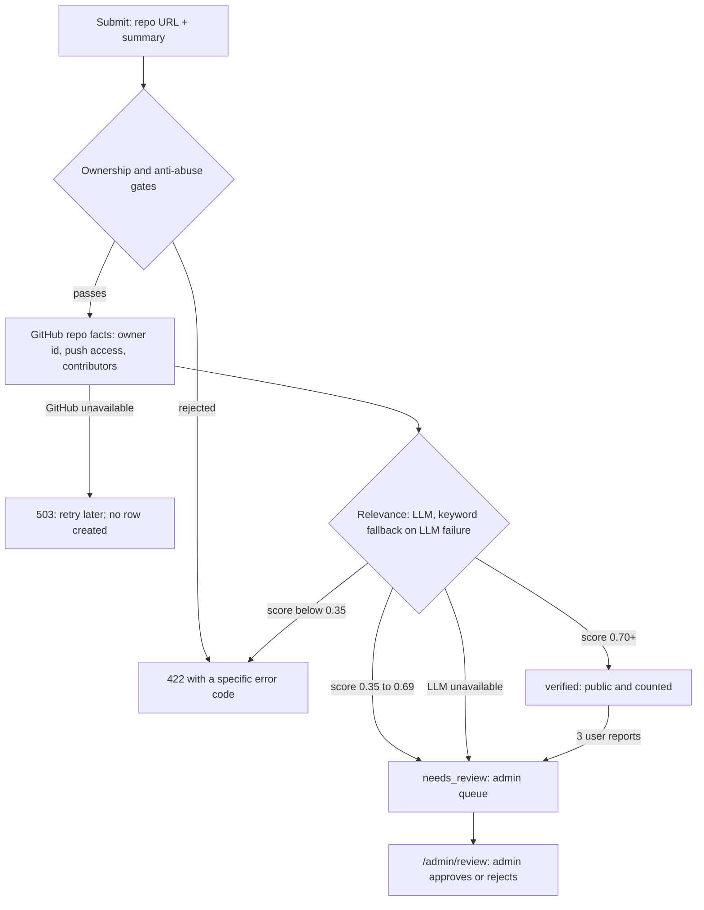

# MANABI

MANABI is a catalog of real problems worth building. Students pick a brief,
link their GitHub repo, and the site tracks their progress from public repo
activity. A chat assistant helps you choose. It deploys as a static React
frontend (Cloudflare Pages) and a FastAPI API (Render) over managed Postgres
(Supabase).

Problem briefs are curated manually, via seed scripts and the app itself; the
catalog needs no external brief source. Automated crawling was evaluated early
on and intentionally removed: several public sources prohibit scraping. The
seed files fill in web and AI/ML briefs.

## What the app does

- Problem board with search plus field, domain, difficulty, tech, and source
  filters
- Problem detail pages with tech stack, starting approaches, a build guide, and
  track-specific extras (resume, hackathon, or learning)
- Submit a project by repo URL (owner/push-access/contributor gates plus an
  LLM relevance check)
- Progress tracking from the GitHub API: commits, README state, open issues,
  cached for 10 minutes with a manual refresh
- Dashboard that lists your projects with edit/remove actions;
  unverified work stays in the needs-review state and is hidden from the
  curated counts until an admin or the verification system clears it
- Viewer reports on published projects; 3 reports flip a project back to
  human review
- Catalog chat (login-only, 20 messages per account per rolling 24 h) with an
  honest mock provider so it runs without an LLM key
- `GET /api/recommendations` scores briefs against your GitHub profile signals
  (topics and languages)
- Admin submissions queue at `/admin/review` (approve/reject), gated by
  `ADMIN_GITHUB_USERNAMES`
- Night mode with a persisted toggle (falls back to the OS preference)

## How it fits together

**Two services:** the React app is a static build served by Cloudflare Pages,
and FastAPI serves every API route under `/api` (it does not serve
`frontend/dist`). The frontend finds the API through `VITE_API_BASE_URL`; the
backend allows that origin and redirects there after login via `FRONTEND_URL`.
SQLite
is the local default, managed Postgres (Neon/Supabase) is the production path,
and provider URLs are normalized to the installed psycopg2 driver with
`pool_pre_ping` enabled automatically. Health checks: `/api/health/live` is
process liveness, while `/api/health` and `/api/health/ready` also touch the
database.

The OpenAPI contract lives at `docs/openapi.json` (regenerate frontend types
with `npm run gen:api` in `frontend/`). The core database tables are `users`,
`problems`, `projects`, `project_reports`, `project_stars`, `problem_stars`,
and `rate_limit_hits`; see `backend/app/models.py`. Alembic migrations are the
schema source of truth in production.

## Project submission and verification

Submitting a repo is gated hard. Anti-abuse limits (5 submissions per rolling
24 h, 10 active projects, 10 submit-button attempts per hour, one GitHub repo
per problem, one submission per user per repo/problem, forks and archived
repos off) apply before GitHub is even contacted. Then the ownership gate
accepts exactly one verifiable basis: the repo owner by GitHub numeric id, push
or admin access for org repos, or 3 or more commits under your own account. An
LLM then judges your README plus summary against the problem brief.



The design rule is failure safety: an LLM outage degrades to human review,
never to an unearned verified badge, and a GitHub outage during submission
returns a retryable 503 before any row is created. Pre-existing repos (older
than 180 days) need a higher score to auto-verify, a project in needs-review
re-checks itself at most once per day on progress refresh, and editing the
summary re-runs the check right away. All knobs are documented in
`backend/.env.example` with their defaults, and the rules live in
`backend/app/services/verification.py`.

## Tech stack

| Layer | Choice | Notes |
|---|---|---|
| Backend | FastAPI, SQLAlchemy 2, Alembic | Python 3.12 (CI); `render.yaml` pins 3.12.7 |
| Database | SQLite locally, Postgres in prod | migrations are the source of truth in prod |
| Auth | GitHub OAuth via Authlib + itsdangerous sessions | tokens stored server-side |
| AI | Gemini or Anthropic, `mock` provider by default | keys optional; chat degrades to 503 without them |
| Frontend | Vite, React 18, TypeScript, Tailwind CSS 4 | Node 22.13+; React Query for data, motion & Radix for UI |
| Tests | pytest + respx, Vitest + Testing Library + MSW, Playwright | backend tests use `LLM_PROVIDER=mock` by default |
| Deploy | Render blueprint (`render.yaml`), plain uvicorn | single service, no separate web tier |

## Repo layout

```
MANABI/
├── backend/
│   ├── app/
│   │   ├── routers/       # problems, projects, auth, chat, admin, stats, ...
│   │   ├── services/      # github, verification, llm, ratelimit, catalog_search, ...
│   │   ├── seed/          # project-importer + seed runners
│   │   ├── models.py      # SQLAlchemy models
│   │   ├── schemas.py     # Pydantic request/response models
│   │   ├── config.py      # all env vars and their defaults
│   │   └── main.py        # app assembly, SPA serving, health
│   ├── alembic/           # migrations (source of truth for Postgres)
│   ├── scripts/           # reverify_projects.py, export_openapi.py
│   ├── .env.example       # every setting with comments and defaults
│   ├── requirements.txt   # runtime deps (pinned)
│   ├── requirements-dev.txt
│   └── start.sh           # prod entrypoint: pip install + uvicorn
├── frontend/
│   ├── src/
│   │   ├── api/           # typed client + MSW mock handlers
│   │   ├── components/    # chat, problems, home, layout, markdown, auth
│   │   ├── pages/         # board, detail pages, dashboard, admin, static pages
│   │   ├── hooks/         # query hooks and mutations
│   │   ├── lib/           # small reusable logic (theme, repo URL rules, ...)
│   │   ├── design/        # primitive components (Input, Dialog, Toast, ...)
│   │   └── test/          # render helpers and setup
│   ├── e2e/               # Playwright smoke test
│   └── dist/              # build output, never committed, built on deploy
├── docs/
│   └── openapi.json       # machine-readable API contract
└── DEPLOY.md              # full production runbook (read this to deploy)
```

### Where to make changes

| Task | Start here |
|---|---|
| App assembly, middleware, SPA fallback | `backend/app/main.py` |
| API routes and status codes | `backend/app/routers/` |
| SQLAlchemy models and table relationships | `backend/app/models.py` |
| Request/response schemas | `backend/app/schemas.py` |
| Verification, GitHub, LLM, rate limits, search | `backend/app/services/` |
| Settings and environment variables | `backend/app/config.py`, `backend/.env.example` |
| Database migrations | `backend/alembic/versions/` |
| Seed briefs | `backend/app/seed/` |
| Backend tests | `backend/tests/` |
| Frontend routes | `frontend/src/App.tsx` |
| Pages, shared components, design primitives | `frontend/src/pages/`, `frontend/src/components/`, `frontend/src/design/` |
| Typed API client, generated types, MSW mocks | `frontend/src/api/` |
| Frontend unit tests | colocated `*.test.tsx` files |
| Browser smoke test | `frontend/e2e/` |

## Quick start (local dev)

Run the backend and frontend in separate terminals.

**Backend, Windows PowerShell:**

```powershell
cd backend
python -m venv .venv
.\.venv\Scripts\python.exe -m pip install -r requirements.txt
Copy-Item .env.example .env
# Edit .env if you want OAuth or a real LLM; mock mode works without keys.
.\.venv\Scripts\python.exe -m alembic upgrade head
.\.venv\Scripts\python.exe -m uvicorn app.main:app --port 8000
```

**Backend, macOS/Linux:**

```sh
cd backend
python3 -m venv .venv
.venv/bin/python -m pip install -r requirements.txt
cp .env.example .env
# Edit .env if you want OAuth or a real LLM; mock mode works without keys.
.venv/bin/python -m alembic upgrade head
.venv/bin/python -m uvicorn app.main:app --port 8000
```

**Frontend (any platform):**

```sh
cd frontend
npm ci
npm run dev   # http://localhost:5173; proxies /api to http://localhost:8000
```

Examples later in this file use the macOS/Linux virtualenv path. On Windows,
replace `.venv/bin/python` with `.venv\Scripts\python.exe`.

### Runtime requirements

- Python 3.12 is the verified runtime (CI targets 3.12; `render.yaml` pins
  3.12.7). Python 3.11 is not covered by CI.
- Node 22.13.0 is the pinned/verified version. `package.json` requires
  Node `>=22.13.0` and npm `>=10`; install with `npm ci`.
- SQLite locally and in tests; production uses Postgres via `DATABASE_URL`.
- The public catalog runs with no external services. GitHub OAuth is needed
  for login, submissions, stars, reports, and the dashboard; Gemini/Anthropic
  are optional.

Mock LLM mode works out of the box, so you can develop the public catalog and
most tests without any provider key.

### Supported platforms and limitations

- Linux is the CI and deployment target. Windows is the current development
  platform. Both were exercised during the compatibility audit; this is not a
  claim that every distribution or Windows release has been tested.
- macOS is not covered by CI and was not verified; treat it as unsupported
  until it is added to the test matrix.
- Python versions other than 3.12 and Node 20 or older are not part of the
  verified matrix. Node 22.13.0 is the pinned LTS baseline.
- No Dockerfile or container deployment configuration is provided.
- Browser support is not formally pinned. Use a current evergreen browser;
  the automated Playwright smoke test covers Chromium only, and legacy
  browsers are unsupported.
- Production requires Postgres, but the repository does not pin a Postgres
  major version. Use the version provided by the deployment platform.

## Seed data and demos

The app starts empty. Load curated brief packs without any network or LLM call:

```sh
cd backend
.venv/bin/python -m app.seed.seed_webdev_projects
.venv/bin/python -m app.seed.seed_webdev_hackathon_projects
.venv/bin/python -m app.seed.seed_webdev_learning_projects
.venv/bin/python -m app.seed.seed_aiml_projects
.venv/bin/python -m app.seed.seed_aiml_hackathon_projects
.venv/bin/python -m app.seed.seed_aiml_learning_projects
```

Append `--update` to refresh rows that already exist, for example
`.venv/bin/python -m app.seed.seed_webdev_projects --update`.

Summaries are clearly generated, never verbatim source text. Seed scripts are
for local setups and demos; the production database is fully curated offline.

## Configuration

All settings read from `backend/.env` (or platform env vars). The ones most
people touch:

| Variable | Default | Purpose |
|---|---|---|
| `APP_ENV` | `development` | Set `production` on a deployed host; startup then rejects localhost, HTTP, and SQLite |
| `DATABASE_URL` | `sqlite:///./app.db` | SQLite locally; managed Postgres in prod |
| `SESSION_SECRET` | placeholder | Long random string; the app refuses to boot non-local with the placeholder |
| `BASE_URL` | `http://localhost:5173` | Public origin; drives the OAuth callback and cookie Secure flag |
| `GITHUB_CLIENT_ID` / `GITHUB_CLIENT_SECRET` | empty | GitHub OAuth app for login |
| `LLM_PROVIDER` | `mock` | `gemini`, `anthropic`, or `mock` |
| `GEMINI_API_KEY` / `GEMINI_MODEL` / `ANTHROPIC_API_KEY` / `LLM_MODEL_FAST` | empty | Provider keys and optional model overrides |
| `GEMINI_API_KEYS_EVAL` / `GEMINI_API_KEYS_CHAT` | empty | Optional ordered, comma-separated key pools for evaluation and chat; exhausted keys rotate out until quota resets |
| `GEMINI_API_KEY_CHAT` / `GEMINI_MODEL_CHAT` | empty | Optional second Gemini project for the catalog chat, so chat shares no quota with evaluation; empty uses the shared key |
| `CHAT_RATE_LIMIT_PER_DAY` | 20 | Chat messages per account per rolling 24 h (login-only) |
| `SUBMIT_RATE_LIMIT_PER_HOUR` | 10 | Submit-button attempts per account per hour (failures count) |
| `PROBLEM_CREATE_PER_HOUR` | 5 | Problem publishing per user per hour (admins get the sanity cap below) |
| `REPORT_RATE_LIMIT_PER_HOUR` | 5 | Project reports per user per hour |
| `STAR_RATE_LIMIT_PER_HOUR` | 60 | Star/unstar toggles per user per hour |
| `AUTH_LOGIN_RATE_LIMIT_PER_HOUR` | 20 | Login redirect + OAuth callback per IP per hour |
| `PROGRESS_REFRESH_RATE_LIMIT_PER_HOUR` | 10 | Forced progress refreshes per user per hour (owners exempt) |
| `ADMIN_RATE_LIMIT_PER_HOUR` | 100 | Shared hourly sanity cap for admin actions |
| `ADMIN_GITHUB_USERNAMES` | empty | Comma-separated GitHub logins allowed into `/admin/review` |
| `CLIENT_ERROR_RATE_LIMIT_PER_HOUR` | 60 | Browser error reports per client IP per hour |
| `LOG_LEVEL` / `LOG_FORMAT` | `INFO` / auto | Structured logs: JSON in production, text elsewhere |
| `SLOW_REQUEST_MS` / `APP_VERSION` | 2000 / empty | Slow-request warning threshold and release stamp for log correlation |

Rate limits are stored in the database (`rate_limit_hits` table), so they
survive restarts and hold under multiple workers. Every 429 response carries a
`Retry-After` header and a message that names the wait ("Try again in about
37 minutes"); the UI shows a live countdown from that header.

Without LLM keys, `POST /api/chat` returns `503 {"detail": "AI is not
configured yet"}`. Submission verification does not fail the request: it falls
back to an offline keyword check that can only reach `needs_review`, never an
automatic verify or reject. The submission-verification thresholds (relevance
scores, commit minimums, per-user limits, fork policy) all have safe defaults
documented in `backend/.env.example`; change them only for a deliberate reason.

## Tests

```sh
# Backend (from backend/)
.venv/bin/python -m pytest -q
# optional: .venv/bin/python -m pytest -q --cov=app --cov-report=term

# Frontend (from frontend/)
npm run typecheck   # tsc --noEmit
npm test            # Vitest unit/integration
npm run build       # typecheck + production bundle
npm run e2e         # Playwright smoke; builds and serves an MSW-mocked app
```

On Windows, replace `.venv/bin/python` with `.venv\Scripts\python.exe`. The
first Playwright run also needs `npx playwright install chromium`.

Backend tests default to `LLM_PROVIDER=mock` and never call a real provider or
GitHub. A few failure-path tests override the provider only to exercise
fallbacks; they still stub the network. The Playwright smoke runs against a
dedicated MSW-mocked build, so it needs no backend.

There is no separate backend linter/formatter configuration in the repository;
match the surrounding style. The frontend type check is `npm run typecheck`
(also run by `npm run build`).

## CI

`.github/workflows/ci.yml` runs on every push and pull request: SQLite and
Postgres Alembic migration smoke checks, the backend suite (Python 3.12, mock
LLM, in-memory SQLite), plus the frontend `npm run build` (typecheck + bundle),
Vitest, and the Playwright smoke test on Chromium. The frontend job reads the
pinned Node version from `.node-version`.

## Deploy

Full runbook with migrations, backup steps, and the verification checklist:
[DEPLOY.md](DEPLOY.md). Summary:

```sh
# Frontend: Cloudflare Pages, root frontend/, build: npm ci && npm run build
# Backend:  Render blueprint (render.yaml), API only
# Set APP_ENV=production plus DATABASE_URL, SESSION_SECRET, BASE_URL,
# FRONTEND_URL, GITHUB_CLIENT_ID/SECRET, and LLM keys on the host; never in git.
```

A `Procfile` and a one-click Render blueprint (`render.yaml`) are included.
Postgres deployments run `alembic upgrade head` automatically at startup; the
runbook covers production guards, backups, rollback, health checks, proxy
trust, and the one-time cleanup and re-verification scripts.

## Docs

- [DEPLOY.md](DEPLOY.md) — full production runbook, env vars, migrations
- [backend/README.md](backend/README.md) — backend setup, configuration, and API surface
- [SECURITY.md](SECURITY.md) — scope, known accepted issues, and how to report a vulnerability
- [CONTRIBUTING.md](CONTRIBUTING.md) — how to work on the project and submit changes
- [CODE_OF_CONDUCT.md](CODE_OF_CONDUCT.md) — expected behavior in project spaces
- [docs/openapi.json](docs/openapi.json) — machine-readable API contract

## License

[MIT](LICENSE).
